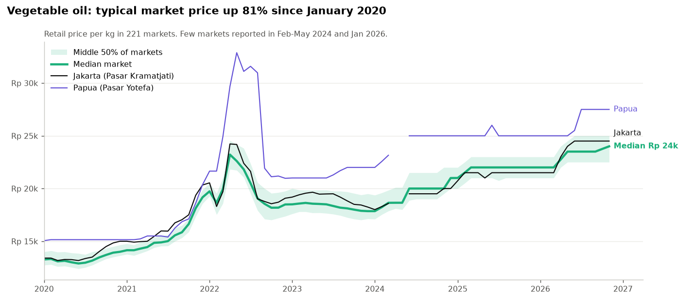
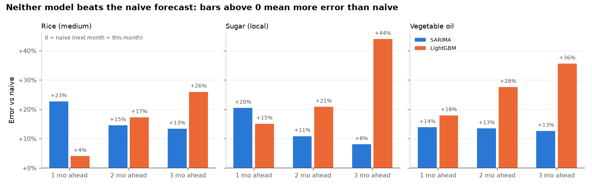

# Indonesia food price forecast and spike alert

Can we see staple food price spikes coming in Indonesian markets, 1 to 3 months ahead?

Monthly retail prices of **medium rice, local sugar and vegetable oil** in about 220 traditional
markets (2020 to 2026, WFP data), forecast with a naive baseline, SARIMA and LightGBM, with an alert
when a market's forecast is more than 15% above its normal trend.

**Live app:** _link added after deploy_ · **Walkthrough:** [`analysis.ipynb`](analysis.ipynb)



## Key results

- **The naive forecast ("next month = this month") is the one to beat, and it won.** In a rolling
  backtest (22 origins, 2021-03 to 2026-08, about 40,000 forecasts per model) SARIMA and LightGBM
  had 4% to 44% higher error than naive at every horizon. Prices are sticky: in 43-64% of
  the one-month cases the price did not change at all.
- **Error is small for rice and sugar, larger for oil:** naive MAPE 0.9% (rice, 1 month) to 5.2%
  (oil, 3 months).
- **For spike alerts the models do add value.** They catch spikes before the price is already above
  the limit: at 1 month LightGBM found 81% of oil spikes (naive 76%) and 75% of rice spikes (naive
  65%); at 3 months 70% of oil spikes (naive 52%), at the cost of more false alarms.

| MAPE, all origins | 1 month | 2 months | 3 months |
|---|---|---|---|
| Rice: naive / SARIMA / LightGBM | 0.91 / 1.12 / 0.95% | 1.69 / 1.93 / 1.98% | 2.41 / 2.73 / 3.03% |
| Sugar: naive / SARIMA / LightGBM | 1.49 / 1.79 / 1.71% | 2.53 / 2.80 / 3.06% | 3.21 / 3.47 / 4.62% |
| Oil: naive / SARIMA / LightGBM | 2.42 / 2.76 / 2.85% | 4.19 / 4.75 / 5.34% | 5.15 / 5.80 / 6.98% |



Full tables: [`reports/model.md`](reports/model.md), [`reports/explore.md`](reports/explore.md).

## Data

| Source | Used for |
|---|---|
| [WFP food prices for Indonesia](https://data.humdata.org/dataset/wfp-food-prices-for-indonesia) (HDX, CC BY-IGO; collected from BPS and PIHPS Bank Indonesia) | Monthly retail price per market, 2007-2026 |
| Same file, `price / usdprice` | Monthly IDR/USD rate |
| [World Bank API](https://data.worldbank.org/country/indonesia): CPI, inflation | Real prices, inflation feature |

Maize is not in the WFP file and wheat flour has only one national series ending in 2020, so the
three staples are rice, sugar and oil.

## Method

1. **Clean** (`prepare.py`): keep per-kg market series, monthly average per market, fill every
   month between a market's first and last report so gaps show. Flag outliers by comparing each market
   with the all-market median first (so the real 2022 cooking-oil crisis is not flagged), then with its
   own rolling median: more than 5 robust SD and 15% away. Fill gaps of up to 2 months.
2. **Explore**: price per market over time, coverage, outliers, nominal vs real, exchange rate
   (figures in [`figures/`](figures)).
3. **Model** (`model.py`): naive; SARIMA(1,1,1)(1,0,0,12) on log price per market; LightGBM per
   food and horizon on lag features of the market, its province and the national median, exchange
   rate changes, last year's inflation and the month. Rolling-origin backtest: each forecast sees only
   data up to its origin month.
4. **Alert**: forecast > 1.15 x trailing 12-month median price of that market. Backtest precision and
   recall in [`reports/backtest_alerts.csv`](reports/backtest_alerts.csv).
5. **App** (`app.py`): pick a food, province and market; see history, outliers, trend, alert limit
   and the forecasts of all three models; list and map of all flagged markets; backtest tables.

## Limits

- Data gaps: almost no market data 2017-04 to 2019-12, about 50 markets 2024-02 to 2024-05, about
  45 in 2026-01. Models use 2020 onwards.
- The source changes in mid-2024 (aggregated to reported prices); many series become step-shaped.
- 16% of SARIMA fits failed or diverged and fell back to naive.
- CPI after 2025 is extrapolated with the last annual inflation rate.
- No weather, policy (price caps, export bans) or global commodity prices yet.

**Next steps:** add global palm oil and rice prices and rainfall, model the spike probability
directly as a classification, tune the alert limit per food.

## Run it

```bash
python -m venv .venv && source .venv/bin/activate
pip install -r requirements.txt
python download_data.py      # raw CSVs from HDX (52 MB, not in the repo)
python prepare.py            # steps 2-3, about 15 s
python model.py --quick      # step 4, last 6 backtest origins, a few minutes
                             # (python model.py = full 22-origin backtest, about 12 min on 8 cores)
streamlit run app.py
```

The processed data (`data/`) and results (`reports/`, `figures/`) are in the repo, so the app runs
without the pipeline, and GitHub shows the notebook with its saved outputs. Re-running the notebook
needs the raw CSVs (`download_data.py`).

## Files

| File | What |
|---|---|
| `download_data.py` | Step 1: download the WFP files from HDX |
| `prepare.py` | Steps 2-3: clean, gaps, outliers, figures, exchange rate and CPI |
| `model.py` | Step 4: backtest, forecasts, alerts |
| `app.py` | Step 5: Streamlit app |
| `analysis.ipynb` | The whole story with code and outputs |
| `common.py` | Shared settings (foods, threshold, colours) |
